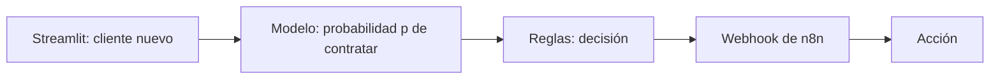
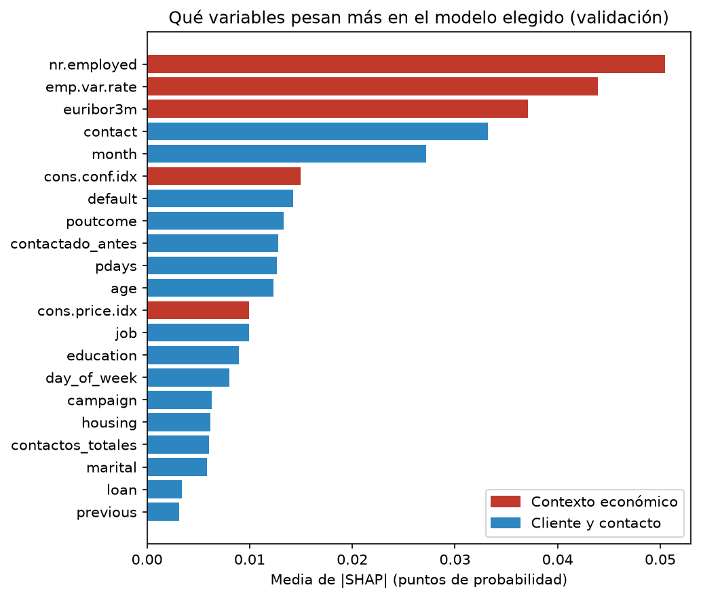

# Predictor de depósitos a plazo · Bank Marketing

Sistema que indica al equipo de telemarketing de un banco **a qué clientes llamar primero** para ofrecerles un depósito a plazo, y activa la acción correspondiente. **De cada 100 clientes que contratan, el modelo detecta 64, y de cada 100 llamadas que recomienda, 42 acaban en venta (frente a 11 llamando sin criterio).**


> **PENDIENTE:** captura de la app de Streamlit (`resultados/app_streamlit.png`). Debe ir arriba del todo.

**Herramientas:** Python · pandas · matplotlib · scikit-learn · imbalanced-learn · XGBoost · SHAP · MLflow · Streamlit · n8n

---

## La necesidad de negocio

Un banco portugués hizo entre 2008 y 2010 una campaña de marketing telefónico para vender un depósito a plazo. En total hizo **41.188 llamadas y solo 4.640 terminaron en contratación: el 11,3 %**. Dicho de otra forma, de cada 100 llamadas, casi 89 no consiguen nada. Cada llamada cuesta tiempo del equipo y, si el cliente ya está cansado de recibirlas, también desgasta la relación con él.

**Objetivo:**

| | |
|---|---|
| Qué predecimos | Si un cliente va a contratar el depósito (`y` = sí / no) y con qué probabilidad |
| Para qué | Priorizar las llamadas: llamar primero a quien más probabilidad tiene y no malgastar llamadas en quien casi seguro dirá que no |
| Quién lo usa | El equipo de telemarketing y el responsable de la campaña |
| Punto de partida | Llamando sin criterio, 11 de cada 100 llamadas dan venta. Ese es el número que queremos superar |
| Tipo de problema | Clasificación binaria |

**Qué mejora supone para la empresa**

> **PENDIENTE:** completar con las métricas del modelo elegido. Estructura a seguir:
>
> | | |
> |---|---|
> | Dato de partida | 41.188 llamadas, 4.640 contrataciones (11,3 %) |
> | Suposición | Coste de una llamada y beneficio de un depósito contratado (**a decidir entre los tres**) |
> | Cálculo | Si llamamos solo al X % de clientes con más probabilidad, conseguimos Y % de las contrataciones con Z llamadas menos |
> | Mejora | Llamadas ahorradas × coste por llamada, o contrataciones extra × beneficio |

## Qué hemos construido



Construimos un sistema que recibe los datos de un cliente (por ejemplo, su trabajo, su edad, cómo se le contactó y el contexto económico), calcula con un modelo de aprendizaje automático la probabilidad `p` de que contrate el depósito, aplica unas reglas de negocio que convierten esa probabilidad en una decisión (llamar ahora, dejarlo para más tarde, no llamar...) y envía esa decisión por webhook a un flujo de n8n que ejecuta la acción. **[PENDIENTE: concretar la acción de n8n cuando esté decidida: Google Sheets, correo, Google Calendar...]**

Cada herramienta cumple una función:

- **pandas y matplotlib:** limpiar y analizar los datos y dibujar los gráficos.
- **scikit-learn:** el preprocesado (en un `Pipeline` común a todos los modelos), los modelos y las métricas.
- **imbalanced-learn (SMOTE):** compensar que hay pocos clientes que contratan.
- **XGBoost:** uno de los modelos que comparamos.
- **SHAP:** explicar qué variables pesan más en el modelo elegido.
- **MLflow:** registrar todos los modelos y experimentos con sus hiperparámetros y métricas, para compararlos.
- **Streamlit:** la app donde evaluamos el modelo con test y predecimos un cliente nuevo.
- **n8n:** el flujo que recibe la decisión y actúa.

**Por qué es una IA débil.** Nuestro sistema hace una sola tarea: predecir si un cliente va a contratar un depósito, y solo con lo que ha aprendido de las llamadas de este banco entre 2008 y 2010. No sabría, por ejemplo, decidir qué interés ofrecer, hablar con el cliente por teléfono ni predecir cualquier otra cosa sin volver a entrenarlo con otros datos. Su ventaja es que es barata, rápida y podemos medir cuánto acierta. Una IA fuerte, que pudiera razonar sobre cualquier problema como lo haría una persona, hoy no existe, y nuestro modelo no se parece a ella: no entiende qué es un depósito ni un banco, solo ha encontrado patrones numéricos en los datos.

**Qué tipo de aprendizaje usa.** Es **aprendizaje supervisado**, de tipo **clasificación binaria**. Es supervisado porque para cada cliente conocemos el resultado real (`y`: contrató o no), y el modelo aprende la relación entre las características del cliente y ese resultado. Es clasificación porque lo que predecimos es una categoría (contrata / no contrata) y no un número. En el aprendizaje no supervisado no hay una etiqueta que predecir: el modelo busca estructura por su cuenta, por ejemplo agrupando clientes parecidos. Eso podría darnos "perfiles de clientes", pero no nos diría quién va a contratar, que es lo que necesita el banco.

## Los datos

**Origen:** *Bank Marketing (with social/economic context)*, del UCI Machine Learning Repository. Son las llamadas de una campaña de telemarketing de un banco portugués, ordenadas por fecha (mayo de 2008 a noviembre de 2010), junto con cinco indicadores socioeconómicos publicados por el Banco de Portugal.

**Tamaño:** 41.188 filas y 21 columnas (20 variables y la variable objetivo). Tras quitar 12 filas duplicadas quedan **41.176**. Separamos un 80 % para train (32.940) y un 20 % para test (8.236), de forma estratificada para que las dos partes mantengan el 11,3 % de contrataciones.

**Variable objetivo:** `y`, si el cliente contrata el depósito.

| Campo | Qué significa | Tipo | % nulos | ¿Se usa? |
|---|---|---|---|---|
| `age` | Edad del cliente | numérica | 0 % | Sí |
| `job` | Tipo de trabajo | categórica | 0,8 % | Sí |
| `marital` | Estado civil (`divorced` incluye viudos) | categórica | 0,2 % | Sí |
| `education` | Nivel de estudios | categórica | 4,2 % | Sí |
| `default` | Tiene crédito en impago | categórica | 20,9 % | Sí |
| `housing` | Tiene préstamo hipotecario | categórica | 2,4 % | Sí |
| `loan` | Tiene préstamo personal | categórica | 2,4 % | Sí |
| `contact` | Tipo de teléfono del contacto (móvil o fijo) | categórica | 0 % | Sí |
| `month` | Mes del último contacto | categórica | 0 % | Sí |
| `day_of_week` | Día de la semana del último contacto | categórica | 0 % | Sí |
| `duration` | Duración de la última llamada en segundos | numérica | 0 % | **No: fuga de datos** |
| `campaign` | Nº de contactos en esta campaña con el cliente | numérica | 0 % | Sí |
| `pdays` | Días desde el último contacto de la campaña anterior (999 = no contactado) | numérica | 0 % | Sí (999 pasa a 0) |
| `previous` | Nº de contactos antes de esta campaña | numérica | 0 % | Sí |
| `poutcome` | Resultado de la campaña anterior | categórica | 0 % | Sí |
| `emp.var.rate` | Variación del empleo (trimestral) | numérica | 0 % | Sí |
| `cons.price.idx` | Índice de precios al consumo (mensual) | numérica | 0 % | Sí |
| `cons.conf.idx` | Índice de confianza del consumidor (mensual) | numérica | 0 % | Sí |
| `euribor3m` | Euríbor a 3 meses (diario) | numérica | 0 % | Sí |
| `nr.employed` | Nº de empleados en el país (trimestral) | numérica | 0 % | Sí |
| `y` | **Objetivo:** el cliente contrata el depósito | binaria | 0 % | Objetivo |

Los nulos vienen escondidos en la categoría `unknown`; no hay `NaN` reales. Los pasamos a `NaN` para tratarlos.

**Lo más importante que descubrimos**

- **Solo el 11,3 % de los clientes contrata**, así que las clases están desbalanceadas. El accuracy no sirve (decir siempre "no" acertaría el 89 %) y comparamos los modelos con y sin SMOTE.
- **Quitamos `duration`.** Solo se conoce después de llamar y ya contiene el resultado (si dura 0 segundos, `y` es siempre "no"). Usarla sería una fuga de datos y el modelo no serviría para decidir a quién llamar.
- **Estudiantes (≈32 %) y jubilados (≈26 %) contratan entre dos y tres veces más que la media**, y los trabajadores `blue-collar` (≈7 %) menos.
- **El contexto económico pesa mucho:** con el euríbor por debajo de 1 contrata alrededor del 45 %, y por encima de 2 menos del 5 %. El euríbor, el empleo y la variación del empleo están correlacionados entre 0,91 y 0,97, así que son casi redundantes.
- **Haber sido contactado en una campaña anterior** multiplica por siete la probabilidad de contratar (≈65 % frente a ≈9 %).


**Cómo tratamos los nulos.** Estudiamos si seguían un patrón y decidimos según el resultado:

| Variable | ¿Al azar? | Tratamiento |
|---|---|---|
| `default` (20,9 %) | Con patrón: los nulos contratan ≈5 % frente a ≈13 %, son algo mayores y se les llamó más a teléfono fijo | Nueva categoría `desconocido` |
| `education` (4,2 %) | Depende de `job` (es nula sobre todo en estudiantes) | Moda de su tipo de trabajo |
| `housing`, `loan`, `job`, `marital` | Al azar o tan pocos que no importa | Moda de train |

Todos los valores de imputación se calculan solo con train.

**Variables nuevas.** `contactado_antes` (1 si `pdays` es distinto de 999) y `contactos_totales` (`campaign` + `previous`). La primera sustituye al código 999, que no es una distancia real y distorsionaría a los modelos que escalan.

El análisis completo, con los cinco gráficos comentados, está en `notebooks/01_eda.ipynb`.

## Resultados

**Métrica principal: recall.** Un cliente que contrata y no detectamos es una venta perdida; un cliente al que llamamos y no contrata es una llamada gastada. Perder la venta nos cuesta más que una llamada, así que priorizamos encontrar a los que contratan. Vigilamos también la **precisión** (de los clientes que marcamos, cuántos contratan de verdad) y el **F1**, que equilibra las dos. Los modelos se comparan con validación cruzada de 5 pliegues sobre train, con los resultados sacados de MLflow.

El notebook [02_modelos_alvaro.ipynb](./notebooks/02_modelos_alvaro.ipynb) compara la regresión logística, KNN y un SVM lineal con el mismo preprocesado. KNN y SVM se registran en MLflow; sus métricas de validación ya están incluidas en la tabla. El notebook [04_modelos_akira.ipynb](./notebooks/04_modelos_akira.ipynb) compara cuatro configuraciones de MLP, cada una con y sin SMOTE; sus medias de validación cruzada se muestran por separado. El notebook [03_modelos_iker.ipynb](./notebooks/03_modelos_iker.ipynb) ajusta Random Forest y XGBoost con `GridSearchCV` (4 configuraciones por modelo, elegidas por F1 de validación), con y sin SMOTE dentro del pipeline; en la tabla aparece la mejor configuración de cada búsqueda y las 16 ejecuciones quedan registradas en MLflow.

| Modelo | Recall (train) | Recall (val) | Precisión (train) | Precisión (val) | F1 (train) | F1 (val) | Tiempo de entrenamiento (s) |
|---|---|---|---|---|---|---|---|
| Regresión logística (base) | 0,235 | 0,231 | 0,677 | 0,664 | 0,349 | 0,343 | 0,3 |
| KNN | 0,964 | 0,298 | 0,999 | 0,481 | 0,981 | 0,368 | 0,270 |
| SVM lineal | 0,624 | 0,622 | 0,352 | 0,352 | 0,450 | 0,450 | 1,276 |
| Random Forest (`class_weight="balanced"`, sin SMOTE) | 0,713 | 0,610 | 0,451 | 0,401 | 0,553 | 0,483 | 4,39 |
| Random Forest (`class_weight="balanced"`, con SMOTE) | 0,587 | 0,507 | 0,565 | 0,474 | 0,576 | **0,490** | 12,63 |
| XGBoost (sin SMOTE) | 0,299 | 0,259 | 0,741 | 0,652 | 0,426 | 0,371 | 1,90 |
| XGBoost (con SMOTE) | 0,480 | 0,469 | 0,485 | 0,474 | 0,483 | 0,471 | 4,94 |

Los resultados de KNN muestran una diferencia grande entre train y validación: aunque alcanza un recall de 0,964 en train, baja a 0,298 en validación, señal de sobreajuste. El SVM lineal es más estable (recall 0,624 frente a 0,622), aunque su precisión es menor (0,352).

Mejores hiperparámetros encontrados en `03_modelos_iker.ipynb`:

| Modelo | Hiperparámetros |
|---|---|
| Random Forest (con y sin SMOTE) | `n_estimators=250`, `max_depth=16`, `min_samples_split=2`, `min_samples_leaf=5`, `max_features="sqrt"`, `class_weight="balanced"` |
| XGBoost sin SMOTE | `n_estimators=300`, `max_depth=5`, `learning_rate=0.03`, `subsample=0.9`, `colsample_bytree=0.8`, `min_child_weight=3`, `reg_lambda=5.0` |
| XGBoost con SMOTE | `n_estimators=300`, `max_depth=3`, `learning_rate=0.03`, `subsample=0.8`, `colsample_bytree=0.8`, `min_child_weight=1`, `reg_lambda=5.0` |

**Random Forest y XGBoost.** Random Forest sin SMOTE tiene el segundo mejor recall de validación (0,610), casi igual que el SVM lineal (0,622) pero con más precisión (0,401 frente a 0,352). Con SMOTE consigue el mejor F1 de todo el proyecto (0,490): gana precisión (+0,073) a cambio de recall (−0,102), y su brecha de F1 entre train y validación (0,086) es la mayor de los cuatro, un indicio leve de sobreajuste. XGBoost sin SMOTE es muy conservador: la mejor precisión (0,652) pero solo detecta a uno de cada cuatro clientes que contratan (recall 0,259). SMOTE le sienta bien: el recall sube 0,209 y el F1 pasa de 0,371 a 0,471, aunque sigue por debajo de Random Forest.

**MLP: validación cruzada de 5 pliegues.** La tabla recoge la media de las métricas de validación de cada ejecución; el tiempo es el promedio de ajuste.

| Configuración | SMOTE | Recall | Precisión | F1 | Tiempo (s) |
|---|---:|---:|---:|---:|---:|
| MLP regularizado | Sí | 0,444 | 0,347 | **0,388** | 10,7 |
| MLP tanh | No | 0,269 | 0,632 | 0,377 | 2,2 |
| MLP base | Sí | 0,405 | 0,337 | 0,367 | 15,5 |
| MLP regularizado | No | 0,248 | 0,656 | 0,359 | 1,6 |
| MLP tanh | Sí | 0,397 | 0,319 | 0,353 | 17,8 |
| MLP profundo | Sí | 0,347 | 0,340 | 0,342 | 18,3 |
| MLP base | No | 0,244 | 0,653 | 0,354 | 2,0 |
| MLP profundo | No | 0,225 | 0,672 | 0,336 | 3,3 |

En las cuatro configuraciones MLP, SMOTE aumenta el recall y reduce la precisión; también incrementa el tiempo de ajuste. La mejor F1 de esta comparación es 0,388, del MLP regularizado con SMOTE. Es un resultado de validación, no una evaluación final con el conjunto de test.

**Primer resultado.** La regresión logística base tiene un recall bajo (0,23) y una precisión alta (0,66), con valores casi iguales en train y validación. No sobreajusta: se queda corta. Con solo un 11 % de compradores, prefiere decir "no" casi siempre y detecta pocos de los que sí contratan.

**Modelo elegido: Random Forest con `class_weight="balanced"` y sin SMOTE.** Lo elegimos por la métrica que prioriza el negocio, el recall, sin descuidar la precisión:

- **Recall de validación de 0,610**, prácticamente igual que el más alto (SVM lineal, 0,622): detecta a 6 de cada 10 clientes que contratan.
- **Más precisión que el SVM** (0,401 frente a 0,352): con un recall casi igual, gasta muchas menos llamadas en clientes que no contratan.
- **F1 de 0,483**, casi empatado con el mejor del proyecto (Random Forest con SMOTE, 0,490). Ese otro modelo pierde 0,10 de recall, que es justo lo que más nos importa, y sobreajusta algo más.
- **Más simple que la versión con SMOTE:** el desbalanceo se compensa con pesos de clase, sin generar clientes sintéticos, y se entrena en un tercio del tiempo (4,4 s frente a 12,6 s).

El modelo se entrena con todo train y se guarda en `models/mejor_modelo.joblib` con `python -m src.entrenar_modelo`, que también lo registra en MLflow (`modelo_elegido_random_forest`).

**Qué variables pesan más según SHAP** ([05_shap.ipynb](./notebooks/05_shap.ipynb)). SHAP se calcula con validación, no con test: separamos un 20 % de train, entrenamos el mismo pipeline con el 80 % restante y explicamos 500 clientes de validación.



- **El momento económico es lo que más pesa.** Las tres primeras variables son el número de empleados del país, la variación del empleo y el euríbor, y las cinco variables económicas suman casi la mitad (≈47 %) de la importancia. Con poco empleo y el euríbor bajo (la crisis de 2009-2010) la probabilidad sube; con la economía en alza, baja.
- **Después, cómo y cuándo se llama:** al móvil sube la probabilidad y al fijo la baja; llamar en mayo la baja.
- **El historial con el banco es la señal más fuerte de cada cliente:** haber sido contactado en la campaña anterior, y sobre todo haber contratado entonces (`poutcome = success`), sube la probabilidad entre 5 y 11 puntos.
- **Los datos personales pesan poco:** edad, trabajo, estudios o préstamos mueven la probabilidad un punto o menos de media.

Tiene sentido y coincide con el EDA, pero confirma una limitación: el modelo aprende más *cuándo* llamar que *a quién* (ver "Limitaciones"). Además, por `class_weight="balanced"` el modelo parte de una probabilidad de 0,50 y no del 11 % real: sus probabilidades sirven para ordenar clientes, y los umbrales de las reglas hay que fijarlos con ellas.

**Resultado con test** (8.236 clientes que el modelo no había visto, 928 de ellos contrataron; evaluado una sola vez en la app de Streamlit, con umbral 0,5):

| Recall | Precisión | F1 |
|---:|---:|---:|
| **0,641** | 0,419 | 0,507 |

Los tres valores son algo mejores que en validación (0,610 / 0,401 / 0,483), así que el modelo generaliza bien y no está sobreajustado.


| | El modelo dice "no contrata" | El modelo dice "contrata" |
|---|---:|---:|
| **No contrata** | 6.483 (llamadas que nos ahorramos) | 825 (**falsos positivos**: llamadas gastadas) |
| **Contrata** | 333 (**falsos negativos**: ventas perdidas) | 595 (ventas detectadas) |

Qué significa para el banco:

- **Detectamos 64 de cada 100 clientes que contratan.** Los otros 36 (los 333 falsos negativos) son ventas perdidas: es el error que más nos cuesta y por eso priorizamos el recall.
- **Llamando solo a los 1.420 clientes que marca el modelo (el 17 % del total) conseguimos 595 de las 928 contrataciones (el 64 %).** Es decir, con 5 de cada 6 llamadas menos obtenemos casi dos tercios de las ventas.
- **De cada 100 llamadas, 42 acaban en venta**, frente a 11 llamando sin criterio: cada llamada rinde casi cuatro veces más.
- A cambio, 825 llamadas (falsos positivos) se hacen a clientes que no contratan. Es el coste aceptado: una llamada gastada cuesta menos que una venta perdida.

**Experimentos en MLflow:**


> **PENDIENTE:** captura de `resultados/mlflow.png`.

## Reglas de negocio y acción

Las reglas están en `src/reglas.py`. Se revisan en orden de prioridad y **la primera que se cumple decide**. R1 y R2 son **reglas de seguridad**: si no podemos fiarnos de `p` o de los datos, decide una persona. R9 es la regla por defecto, para que ningún cliente se quede sin decisión.

| Prioridad | Regla | Decisión | Por qué |
|---|---|---|---|
| 1 | **Seguridad:** `p` vacía o fuera de 0-1 | `REVISION_MANUAL` | Sin una probabilidad fiable no se decide automáticamente |
| 2 | **Seguridad:** faltan datos o hay valores imposibles (edad fuera de 18-100…) | `REVISION_MANUAL` | Con datos erróneos la predicción no es fiable |
| 3 | `campaign` ≥ 10 | `NO_LLAMAR` | Cliente saturado: insistir desgasta la relación, aunque `p` sea alta |
| 4 | `p` ≥ 0,50 | `LLAMAR_AHORA` | Es más probable que contrate que no: las llamadas más rentables |
| 5 | Éxito en la campaña anterior y `p` ≥ 0,25 | `LLAMAR_AHORA` | Esos clientes contratan ≈65 % de las veces (EDA) |
| 6 | `p` ≥ 0,25 | `LLAMAR_ESTA_SEMANA` | Más del doble de la tasa base: merece llamada, tras los prioritarios |
| 7 | Estudiante o jubilado y `p` ≥ 0,113 | `LLAMAR_ESTA_SEMANA` | Contratan 2-3 veces más que la media (EDA) |
| 8 | `p` ≥ 0,113 | `ENVIAR_EMAIL` | Mejor que llamar al azar, pero no compensa una llamada; el correo es casi gratis |
| 9 | Resto (`p` < 0,113) | `NO_LLAMAR` | Peor que llamar sin criterio: ese tiempo va a clientes con más opciones |

**Acción en n8n** (`n8n/flujo.json`): el webhook recibe la decisión y hace una acción distinta en cada rama.

| Decisión | Acción |
|---|---|
| `LLAMAR_AHORA` | Evento en Google Calendar para llamar dentro de 1 hora |
| `LLAMAR_ESTA_SEMANA` | Fila en la hoja `cola_llamadas` de Google Sheets |
| `ENVIAR_EMAIL` | Correo informativo al cliente con Gmail |
| `NO_LLAMAR` | Fila en la hoja `no_llamar` de Google Sheets |
| `REVISION_MANUAL` | Correo al supervisor con Gmail |

> Los umbrales (0,50 / 0,25 / 0,113) hay que revisarlos con las probabilidades del modelo elegido en validación.

## Limitaciones y próximos pasos

- **Datos de otra época y otro país.** Son llamadas de un banco portugués de 2008 a 2010, en plena crisis. El modelo podría no funcionar igual hoy ni en otro mercado.
- **Los indicadores económicos son del periodo, no del cliente.** Pesan mucho, pero pueden hacer que el modelo aprenda más "cuándo se llamó" que "a quién". Hacemos la separación train/test al azar, no por fechas, así que conviene probar una separación temporal.
- **Solo conocemos el resultado de los clientes a los que se llamó.** No sabemos qué habría hecho quien no recibió llamada.
- **Variables económicas casi duplicadas** (correlación de 0,91 a 0,97), a tener en cuenta con los modelos lineales.
- **Reentrenar** el modelo cuando haya campañas nuevas.

## Estructura del proyecto

```
prediccion-deposito-banco/
├── README.md
├── requirements.txt
├── data/
│   ├── raw/                 bank-additional-full.csv (original)
│   └── processed/           X_train, X_test, y_train, y_test
├── notebooks/
│   ├── 01_eda.ipynb              EDA, nulos y separación train/test
│   ├── 02_modelos_alvaro.ipynb
│   ├── 03_modelos_iker.ipynb
│   ├── 04_modelos_akira.ipynb
│   └── 05_shap.ipynb             SHAP del modelo elegido (validación)
├── src/
│   ├── utils.py             funciones del proyecto (pipeline, métricas, MLflow)
│   ├── entrenar_modelo.py   entrena y guarda el modelo elegido
│   ├── reglas.py            reglas de negocio
│   └── n8n.py               envío de la decisión al webhook
├── app/
│   └── streamlit_app.py     aplicación
├── models/                  mejor_modelo.joblib
├── n8n/                     flujo.json
└── resultados/              gráficos y capturas de MLflow y de la app
```

## Cómo ejecutarlo

```bash
# 1. Instalar dependencias
python -m venv .venv
source .venv/bin/activate        # en Windows: .venv\Scripts\activate
pip install -r requirements.txt

# 2. Descargar bank-additional-full.csv del UCI y dejarlo en data/raw/
#    http://archive.ics.uci.edu/ml/datasets/Bank+Marketing

# 3. Ejecutar los notebooks en orden (01 primero: genera data/processed/)

# 4. Ver los experimentos
mlflow ui --backend-store-uri sqlite:///mlflow.db

# 5. Entrenar y guardar el modelo elegido (models/mejor_modelo.joblib)
python -m src.entrenar_modelo

# 6. Abrir la aplicación
streamlit run app/streamlit_app.py
```

## Referencias

Dataset: S. Moro, P. Cortez y P. Rita. *A Data-Driven Approach to Predict the Success of Bank Telemarketing*. Decision Support Systems, 2014. doi:10.1016/j.dss.2014.03.001

## Autoría

Akira · Iker · Álvaro

Proyecto del Curso de Especialización en Inteligencia Artificial y Big Data · 2026-27