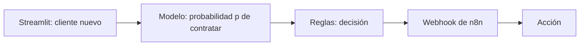
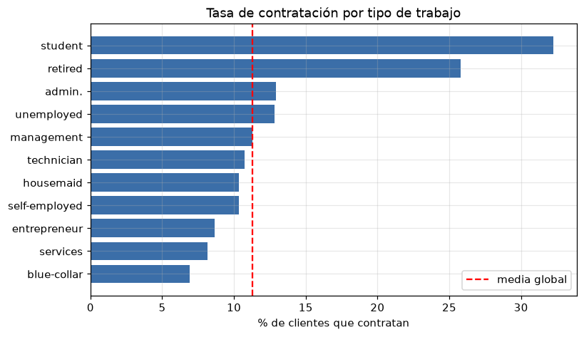
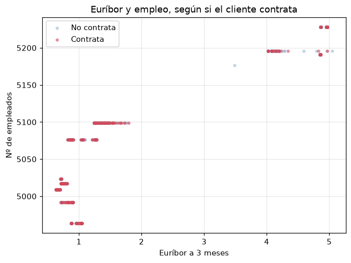
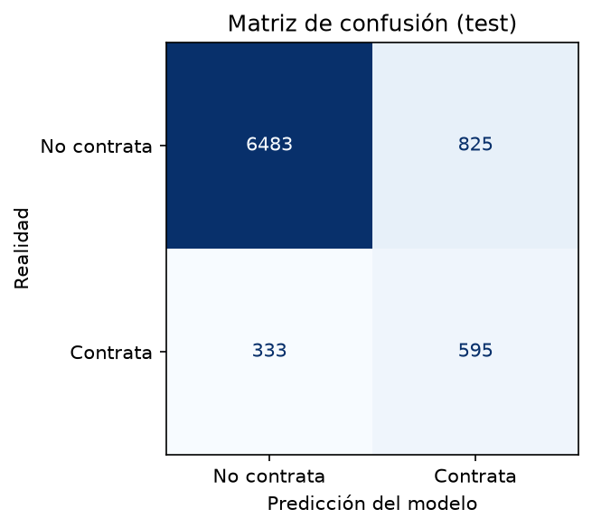

# Predictor de depósitos a plazo · Bank Marketing

Sistema que indica al equipo de telemarketing de un banco **a qué clientes llamar primero** para ofrecerles un depósito a plazo, y activa la acción correspondiente. **[PENDIENTE: resultado, p. ej. "De cada 100 clientes que contratan, el modelo detecta X"]**


> **PENDIENTE:** captura de la app de Streamlit (`resultados/app_streamlit.png`). Debe ir arriba del todo.

**Herramientas:** Python · pandas · matplotlib · scikit-learn · imbalanced-learn · XGBoost · SHAP · MLflow · Streamlit · n8n

---

## La necesidad de negocio

Un banco portugués hizo entre 2008 y 2010 una campaña de marketing telefónico para vender un depósito a plazo. En total hizo **41.188 llamadas y solo 4.640 terminaron en contratación: el 11,3 %**. Dicho de otra forma, de cada 100 llamadas, casi 89 no consiguen nada. Cada llamada cuesta tiempo del equipo y, si el cliente ya está cansado de recibirlas, también desgasta la relación con él.

**Objetivo:**

| | |
|---|---|
| Qué predecimos | Si un cliente va a contratar el depósito (`y` = sí / no) y con qué probabilidad |
| Para qué | Priorizar las llamadas: llamar primero a quien más probabilidad tiene y no malgastar llamadas en quien casi seguro dirá que no |
| Quién lo usa | El equipo de telemarketing y el responsable de la campaña |
| Punto de partida | Llamando sin criterio, 11 de cada 100 llamadas dan venta. Ese es el número que queremos superar |
| Tipo de problema | Clasificación binaria |

**Qué mejora supone para la empresa**

> **PENDIENTE:** completar con las métricas del modelo elegido. Estructura a seguir:
>
> | | |
> |---|---|
> | Dato de partida | 41.188 llamadas, 4.640 contrataciones (11,3 %) |
> | Suposición | Coste de una llamada y beneficio de un depósito contratado (**a decidir entre los tres**) |
> | Cálculo | Si llamamos solo al X % de clientes con más probabilidad, conseguimos Y % de las contrataciones con Z llamadas menos |
> | Mejora | Llamadas ahorradas × coste por llamada, o contrataciones extra × beneficio |

## Qué hemos construido



Construimos un sistema que recibe los datos de un cliente (por ejemplo, su trabajo, su edad, cómo se le contactó y el contexto económico), calcula con un modelo de aprendizaje automático la probabilidad `p` de que contrate el depósito, aplica unas reglas de negocio que convierten esa probabilidad en una decisión (llamar ahora, dejarlo para más tarde, no llamar...) y envía esa decisión por webhook a un flujo de n8n que ejecuta la acción. **[PENDIENTE: concretar la acción de n8n cuando esté decidida: Google Sheets, correo, Google Calendar...]**

Cada herramienta cumple una función:

- **pandas y matplotlib:** limpiar y analizar los datos y dibujar los gráficos.
- **scikit-learn:** el preprocesado (en un `Pipeline` común a todos los modelos), los modelos y las métricas.
- **imbalanced-learn (SMOTE):** compensar que hay pocos clientes que contratan.
- **XGBoost:** uno de los modelos que comparamos.
- **SHAP:** explicar qué variables pesan más en el modelo elegido.
- **MLflow:** registrar todos los modelos y experimentos con sus hiperparámetros y métricas, para compararlos.
- **Streamlit:** la app donde evaluamos el modelo con test y predecimos un cliente nuevo.
- **n8n:** el flujo que recibe la decisión y actúa.

**Por qué es una IA débil.** Nuestro sistema hace una sola tarea: predecir si un cliente va a contratar un depósito, y solo con lo que ha aprendido de las llamadas de este banco entre 2008 y 2010. No sabría, por ejemplo, decidir qué interés ofrecer, hablar con el cliente por teléfono ni predecir cualquier otra cosa sin volver a entrenarlo con otros datos. Su ventaja es que es barata, rápida y podemos medir cuánto acierta. Una IA fuerte, que pudiera razonar sobre cualquier problema como lo haría una persona, hoy no existe, y nuestro modelo no se parece a ella: no entiende qué es un depósito ni un banco, solo ha encontrado patrones numéricos en los datos.

**Qué tipo de aprendizaje usa.** Es **aprendizaje supervisado**, de tipo **clasificación binaria**. Es supervisado porque para cada cliente conocemos el resultado real (`y`: contrató o no), y el modelo aprende la relación entre las características del cliente y ese resultado. Es clasificación porque lo que predecimos es una categoría (contrata / no contrata) y no un número. En el aprendizaje no supervisado no hay una etiqueta que predecir: el modelo busca estructura por su cuenta, por ejemplo agrupando clientes parecidos. Eso podría darnos "perfiles de clientes", pero no nos diría quién va a contratar, que es lo que necesita el banco.

## Los datos

**Origen:** *Bank Marketing (with social/economic context)*, del UCI Machine Learning Repository. Son las llamadas de una campaña de telemarketing de un banco portugués, ordenadas por fecha (mayo de 2008 a noviembre de 2010), junto con cinco indicadores socioeconómicos publicados por el Banco de Portugal.

**Tamaño:** 41.188 filas y 21 columnas (20 variables y la variable objetivo). Tras quitar 12 filas duplicadas quedan **41.176**. Separamos un 80 % para train (32.940) y un 20 % para test (8.236), de forma estratificada para que las dos partes mantengan el 11,3 % de contrataciones.

**Variable objetivo:** `y`, si el cliente contrata el depósito.

| Campo | Qué significa | Tipo | % nulos | ¿Se usa? |
|---|---|---|---|---|
| `age` | Edad del cliente | numérica | 0 % | Sí |
| `job` | Tipo de trabajo | categórica | 0,8 % | Sí |
| `marital` | Estado civil (`divorced` incluye viudos) | categórica | 0,2 % | Sí |
| `education` | Nivel de estudios | categórica | 4,2 % | Sí |
| `default` | Tiene crédito en impago | categórica | 20,9 % | Sí |
| `housing` | Tiene préstamo hipotecario | categórica | 2,4 % | Sí |
| `loan` | Tiene préstamo personal | categórica | 2,4 % | Sí |
| `contact` | Tipo de teléfono del contacto (móvil o fijo) | categórica | 0 % | Sí |
| `month` | Mes del último contacto | categórica | 0 % | Sí |
| `day_of_week` | Día de la semana del último contacto | categórica | 0 % | Sí |
| `duration` | Duración de la última llamada en segundos | numérica | 0 % | **No: fuga de datos** |
| `campaign` | Nº de contactos en esta campaña con el cliente | numérica | 0 % | Sí |
| `pdays` | Días desde el último contacto de la campaña anterior (999 = no contactado) | numérica | 0 % | Sí (999 pasa a 0) |
| `previous` | Nº de contactos antes de esta campaña | numérica | 0 % | Sí |
| `poutcome` | Resultado de la campaña anterior | categórica | 0 % | Sí |
| `emp.var.rate` | Variación del empleo (trimestral) | numérica | 0 % | Sí |
| `cons.price.idx` | Índice de precios al consumo (mensual) | numérica | 0 % | Sí |
| `cons.conf.idx` | Índice de confianza del consumidor (mensual) | numérica | 0 % | Sí |
| `euribor3m` | Euríbor a 3 meses (diario) | numérica | 0 % | Sí |
| `nr.employed` | Nº de empleados en el país (trimestral) | numérica | 0 % | Sí |
| `y` | **Objetivo:** el cliente contrata el depósito | binaria | 0 % | Objetivo |

Los nulos vienen escondidos en la categoría `unknown`; no hay `NaN` reales. Los pasamos a `NaN` para tratarlos.

**Lo más importante que descubrimos**

- **Solo el 11,3 % de los clientes contrata**, así que las clases están desbalanceadas. El accuracy no sirve (decir siempre "no" acertaría el 89 %) y comparamos los modelos con y sin SMOTE.
- **Quitamos `duration`.** Solo se conoce después de llamar y ya contiene el resultado (si dura 0 segundos, `y` es siempre "no"). Usarla sería una fuga de datos y el modelo no serviría para decidir a quién llamar.
- **Estudiantes (≈32 %) y jubilados (≈26 %) contratan entre dos y tres veces más que la media**, y los trabajadores `blue-collar` (≈7 %) menos.
- **El contexto económico pesa mucho:** con el euríbor por debajo de 1 contrata alrededor del 45 %, y por encima de 2 menos del 5 %. El euríbor, el empleo y la variación del empleo están correlacionados entre 0,91 y 0,97, así que son casi redundantes.
- **Haber sido contactado en una campaña anterior** multiplica por siete la probabilidad de contratar (≈65 % frente a ≈9 %).




**Cómo tratamos los nulos.** Estudiamos si seguían un patrón y decidimos según el resultado:

| Variable | ¿Al azar? | Tratamiento |
|---|---|---|
| `default` (20,9 %) | Con patrón: los nulos contratan ≈5 % frente a ≈13 %, son algo mayores y se les llamó más a teléfono fijo | Nueva categoría `desconocido` |
| `education` (4,2 %) | Depende de `job` (es nula sobre todo en estudiantes) | Moda de su tipo de trabajo |
| `housing`, `loan`, `job`, `marital` | Al azar o tan pocos que no importa | Moda de train |

Todos los valores de imputación se calculan solo con train.

**Variables nuevas.** `contactado_antes` (1 si `pdays` es distinto de 999) y `contactos_totales` (`campaign` + `previous`). La primera sustituye al código 999, que no es una distancia real y distorsionaría a los modelos que escalan.

El análisis completo, con los cinco gráficos comentados, está en `notebooks/01_eda.ipynb`.

## Resultados

**Métrica principal: recall.** Un cliente que contrata y no detectamos es una venta perdida; un cliente al que llamamos y no contrata es una llamada gastada. Perder la venta nos cuesta más que una llamada, así que priorizamos encontrar a los que contratan. Vigilamos también la **precisión** (de los clientes que marcamos, cuántos contratan de verdad) y el **F1**, que equilibra las dos. Los modelos se comparan con validación cruzada de 5 pliegues sobre train, con los resultados sacados de MLflow.

El notebook [02_modelos_alvaro.ipynb](./notebooks/02_modelos_alvaro.ipynb) compara la regresión logística, KNN y un SVM lineal con ese mismo preprocesado y validación. KNN y SVM se registran en MLflow; sus resultados se añadirán a esta tabla cuando se ejecute el notebook con los datos procesados.

| Modelo | Recall (train) | Recall (val) | Precisión (train) | Precisión (val) | F1 (train) | F1 (val) | Tiempo (s) |
|---|---|---|---|---|---|---|---|
| Regresión logística (base) | 0,235 | 0,231 | 0,677 | 0,664 | 0,349 | 0,343 | 0,3 |
| KNN | — | — | — | — | — | — | — |
| SVM | — | — | — | — | — | — | — |
| Random Forest | — | — | — | — | — | — | — |
| XGBoost | — | — | — | — | — | — | — |
| MLP (base y 3 experimentos) | — | — | — | — | — | — | — |

> **PENDIENTE:** completar la tabla con los modelos que faltan, la comparación con y sin SMOTE y el experimento opcional con algo no visto en clase. La fila de regresión logística ya viene de MLflow.

**Primer resultado.** La regresión logística base tiene un recall bajo (0,23) y una precisión alta (0,66), con valores casi iguales en train y validación. No sobreajusta: se queda corta. Con solo un 11 % de compradores, prefiere decir "no" casi siempre y detecta pocos de los que sí contratan.

**Modelo elegido:** **PENDIENTE.** Explicar por qué (qué métrica priorizamos según el negocio y, si hay empate, el modelo más simple) y qué variables pesan más según **SHAP**, calculado con validación y no con test.

**Resultado con test** (clientes que el modelo no había visto, evaluado una sola vez en la app de Streamlit): **PENDIENTE.** Recall, precisión, F1 y matriz de confusión, y qué significan sus errores para el banco (falsos negativos = ventas perdidas, falsos positivos = llamadas gastadas).



**Experimentos en MLflow:**


> **PENDIENTE:** capturas de `resultados/matriz_confusion.png` y `resultados/mlflow.png`.

## Reglas de negocio y acción

> **PENDIENTE.** Las reglas viven en `src/reglas.py`: **6 o más**, cada una con prioridad, decisión y por qué, y **una regla de seguridad**. El flujo de n8n recibe la decisión por webhook y hace una acción distinta para cada una. Tabla a rellenar:
>
> | Prioridad | Regla | Decisión | Por qué |
> |---|---|---|---|
> | 1 | *(regla de seguridad)* | | |
> | 2 | | | |
> | … | | | |

## Limitaciones y próximos pasos

- **Datos de otra época y otro país.** Son llamadas de un banco portugués de 2008 a 2010, en plena crisis. El modelo podría no funcionar igual hoy ni en otro mercado.
- **Los indicadores económicos son del periodo, no del cliente.** Pesan mucho, pero pueden hacer que el modelo aprenda más "cuándo se llamó" que "a quién". Hacemos la separación train/test al azar, no por fechas, así que conviene probar una separación temporal.
- **Solo conocemos el resultado de los clientes a los que se llamó.** No sabemos qué habría hecho quien no recibió llamada.
- **Variables económicas casi duplicadas** (correlación de 0,91 a 0,97), a tener en cuenta con los modelos lineales.
- **Reentrenar** el modelo cuando haya campañas nuevas.

## Estructura del proyecto

```
prediccion-deposito-banco/
├── README.md
├── requirements.txt
├── data/
│   ├── raw/                 bank-additional-full.csv (original)
│   └── processed/           X_train, X_test, y_train, y_test
├── notebooks/
│   ├── 01_eda.ipynb              EDA, nulos y separación train/test
│   ├── 02_modelos_alvaro.ipynb
│   ├── 03_modelos_iker.ipynb
│   └── 04_modelos_akira.ipynb
├── src/
│   ├── utils.py             funciones del proyecto (pipeline, métricas, MLflow)
│   ├── reglas.py            reglas de negocio
│   └── n8n.py               envío de la decisión al webhook
├── app/
│   └── streamlit_app.py     aplicación
├── models/                  mejor_modelo.joblib
├── n8n/                     flujo.json
└── resultados/              gráficos y capturas de MLflow y de la app
```

## Cómo ejecutarlo

```bash
# 1. Instalar dependencias
python -m venv .venv
source .venv/bin/activate        # en Windows: .venv\Scripts\activate
pip install -r requirements.txt

# 2. Descargar bank-additional-full.csv del UCI y dejarlo en data/raw/
#    http://archive.ics.uci.edu/ml/datasets/Bank+Marketing

# 3. Ejecutar los notebooks en orden (01 primero: genera data/processed/)

# 4. Ver los experimentos
mlflow ui --backend-store-uri sqlite:///mlflow.db

# 5. Abrir la aplicación
streamlit run app/streamlit_app.py
```

## Referencias

Dataset: S. Moro, P. Cortez y P. Rita. *A Data-Driven Approach to Predict the Success of Bank Telemarketing*. Decision Support Systems, 2014. doi:10.1016/j.dss.2014.03.001

## Autoría

Akira · Iker · Álvaro

Proyecto del Curso de Especialización en Inteligencia Artificial y Big Data · 2026-27