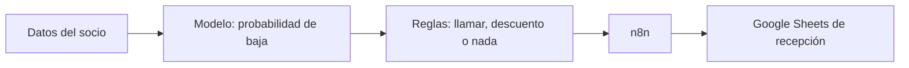

<!--
  EJEMPLO DE README (caso ficticio). Es un consejo, no una plantilla obligatoria.
  Adaptadlo a vuestro proyecto: lo que importa es que quien lo lea entienda en 30 segundos
  qué problema resolvéis, con qué resultado y qué sabéis hacer.
-->

# Detector de bajas de socios · KirolGym

Sistema que avisa a recepción de qué socios están a punto de darse de baja, para llamarles antes de que se vayan. **De cada 100 socios que se iban, el modelo detecta 77**, lo que supondría unos 24.000 € al año en cuotas que no se pierden.

![Aplicación en Streamlit]

**Herramientas:** Python · pandas · matplotlib · scikit-learn · XGBoost · MLflow · Streamlit · n8n

---

## El problema

KirolGym tiene 5 gimnasios en Bizkaia y 800 socios. En el último año se dieron de baja 233 (el 29 %). Recepción se entera cuando el socio ya ha entregado la tarjeta, y entonces no hay nada que hacer.

**Objetivo:** predecir qué socios tienen más probabilidad de darse de baja para que recepción les llame a tiempo.

| | |
|---|---|
| Tipo de problema | Clasificación binaria (se va / sigue) |
| Quién lo usa | Recepción, que recibe cada semana la lista de socios a llamar |
| Otra empresa que hace algo parecido | Las operadoras de telefonía detectan los clientes que se van a ir y les ofrecen un descuento antes de que lo hagan |

## Qué hemos construido



Diagrama hecho con [Mermaid](https://mermaid.ai/): GitHub lo dibuja automáticamente.

El modelo calcula la probabilidad de que el socio se vaya. Las reglas deciden qué hacer según esa probabilidad y los datos del socio (por ejemplo, si tiene quejas abiertas). n8n apunta la decisión en la hoja que usa recepción.

**Tipo de IA.** Es una IA débil: hace una sola tarea, predecir si un socio se va a dar de baja, y solo con lo que ha aprendido de los datos del gimnasio. No sabría, por ejemplo, decidir qué precio poner a una cuota o atender a un socio que llama por teléfono. Su ventaja es que es barata, rápida y se puede comprobar si acierta. Una IA fuerte, que pudiera razonar sobre cualquier problema como una persona, hoy no existe.

## Los datos

800 socios y 12 columnas. Dataset ficticio creado para este ejemplo.

| Campo | Qué significa | Tipo | Nulos |
|---|---|---|---|
| `socio_id` | Identificador del socio (se descarta) | texto | 0 % |
| `gimnasio` | Gimnasio en el que está apuntado | categórica | 0 % |
| `plan` | Básico, Premium o Familiar | categórica | 0 % |
| `canal_alta` | Si se dio de alta online o en recepción | categórica | 0 % |
| `edad` | Edad en años | numérica | 14,4 % |
| `meses_antiguedad` | Meses que lleva apuntado | numérica | 0 % |
| `visitas_mes` | Visitas al gimnasio en el último mes | numérica | 0 % |
| `clases_dirigidas` | Si va a clases dirigidas | categórica | 3,4 % |
| `quejas_trimestre` | Quejas en los últimos tres meses | numérica | 0 % |
| `distancia_km` | Distancia de su casa al gimnasio | numérica | 6,6 % |
| `cuota_mensual` | Cuota en euros (se descarta: repite el plan) | numérica | 0 % |
| `baja` | **Variable objetivo:** 1 si se dio de baja | binaria | 0 % |

**Lo más importante que descubrimos**

- Los socios que se van visitan menos el gimnasio (8 visitas al mes frente a 9) y llevan menos tiempo apuntados (12 meses frente a 16).
- El plan Básico tiene un 36 % de bajas, casi el doble que el Premium (20 %).
- La edad falta en el 23 % de las altas online y solo en el 3 % de las de recepción. No es al azar, así que la rellenamos con la mediana de cada plan, calculada solo con los datos de entrenamiento.


## Resultados

**Métrica principal: recall.** Perder un socio cuesta su cuota durante muchos meses; llamar a uno que iba a seguir cuesta una llamada. Preferimos encontrar a casi todos los que se van.

Resultados con validación cruzada (5 pliegues) sobre los datos de entrenamiento, sacados de MLflow:

| Modelo | Recall (train) | Recall (validación) | F1 (validación) | Tiempo (s) |
|---|---|---|---|---|
| KNN | 0,80 | 0,76 | 0,51 | 3,3 |
| SVM | 0,74 | 0,67 | 0,51 | 2,3 |
| **Regresión logística** | **0,68** | **0,65** | **0,52** | **3,0** |
| XGBoost | 0,70 | 0,52 | 0,49 | 2,1 |
| Random Forest | 0,72 | 0,51 | 0,47 | 6,2 |
| Red neuronal MLP (mejor experimento) | 0,90 | 0,43 | 0,42 | 12,8 |

**Modelo elegido: regresión logística.** No es el de mejor recall, y lo elegimos igualmente:

- Empata con SVM y es más sencilla.
- Tiene el mejor F1. KNN encuentra más bajas, pero 62 de cada 100 avisos serían falsos y recepción perdería el tiempo.
- Se puede explicar: recepción entiende por qué el sistema avisa de un socio.

**Resultado con test** (socios que el modelo no había visto): recall 0,77 · F1 0,59 · precisión 0,48. De los 47 socios que se fueron, el modelo detectó 36.

[Matriz de confusión]


Todos los experimentos están registrados en MLflow:

![MLflow]

## Qué aporta a la empresa

| | |
|---|---|
| Dato de partida | 233 bajas al año, con una cuota media de 44 € |
| Suposición | 1 de cada 4 socios avisados que iban a irse se queda tras la llamada |
| Cálculo | 233 × 0,77 ≈ 179 socios detectados → 179 ÷ 4 ≈ 45 retenidos → 45 × 44 € × 12 meses |
| Mejora | **Unos 23.760 € al año**, a cambio de unas 370 llamadas al año |

## Limitaciones y próximos pasos

- Con 800 socios hay pocos datos. Con más, la red neuronal o XGBoost podrían superar a la regresión logística.
- El modelo dice quién se va, pero no por qué. El siguiente paso es usar SHAP para explicar cada aviso.
- Habría que volver a entrenarlo cada trimestre con los socios nuevos.

## Estructura del proyecto

```
prediccion-bajas-gimnasio/
├── data/
│   ├── raw/                 datos originales
│   └── processed/           train y test
├── notebooks/
│   ├── 01_eda.ipynb         análisis de los datos
│   ├── 02_modelos_ane.ipynb
│   └── 03_modelos_jon.ipynb
├── src/
│   ├── utils.py             funciones del proyecto
│   ├── reglas.py            reglas de negocio
│   └── n8n.py               envío de la decisión a n8n
├── app/
│   └── streamlit_app.py     aplicación
├── models/                  modelo elegido
├── n8n/                     flujo exportado
├── resultados/              capturas
└── requirements.txt
```

## Cómo ejecutarlo

# Ver los experimentos
mlflow ui

# Abrir la aplicación
streamlit run app/streamlit_app.py
```

## Autoría

Ane LinkedIn (https://www.linkedin.com/in/) 
Jon Larr ea  (https://www.linkedin.com/in/) 

Proyecto del Curso de Especialización en Inteligencia Artificial y Big Data · 2026-27
